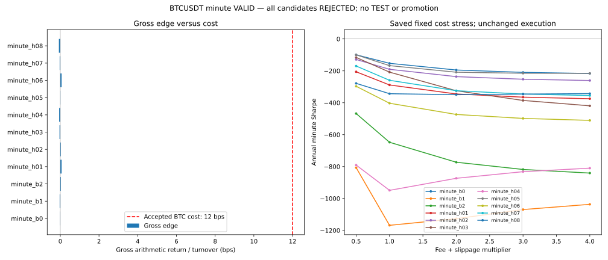

# Minute cost reality (157)

This is a read-only derivation from all eleven step-156 BTCUSDT VALID results.
Every input is checked against its database artifact SHA-256 before use. No
candidate is reevaluated, tuned or promoted; TEST remains untouched.

The left panel divides gross arithmetic reference return by the associated
turnover and compares it with accepted **12 bps per side** (10 taker + 2 slippage).
Gross, cost and net totals use the same available periods and must reconcile.
These totals describe arithmetic reference P&L, not compounded wealth or a
solvent portfolio path. Negative totals below -1 can occur in this convention.
The right panel uses every stored 0.5x/1x/2x/3x/4x fee-and-slippage stress point
with unchanged execution. All eleven candidates remain REJECTED; their saved net
returns are negative even at half costs. The plot does not establish an
independent out-of-sample edge.

The companion JSON records input run IDs, checksums, exact totals, five-point
curves and plot checksums. Large per-period evidence remains outside Git.
Regenerate into a fresh directory with `scripts/report_minute_costs.py`; existing
report directories are refused. Tests cover paired arithmetic reconciliation,
unavailable performance and actual SVG/PNG rendering.
