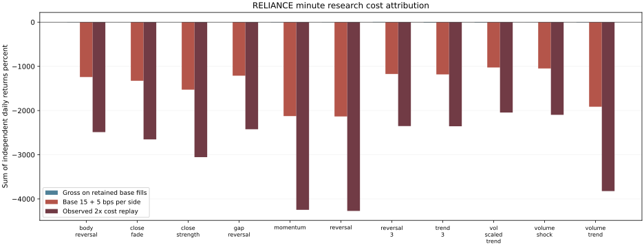

# NSE equity research closeout review

Measured review only. No promotion, TEST access or selection-row mutation.

| Round | Attempts | Status counts |
|---|---:|---|
| nse_hourly_round1 | 150 | {'REJECTED': 100, 'INVALID': 50} |
| nse_hourly_reference | 50 | {'REJECTED': 50} |
| nse_hourly_round2 | 400 | {'REJECTED': 400} |
| nse_minute_round1 | 12 | {'REJECTED': 11, 'INVALID': 1} |

All twelve hourly hypothesis types were tested across the 50-company cohort. The minute model used all 50 stocks for TRAIN, while its twelve execution attempts used RELIANCE only.

## Cost attribution

The chart sums independent flat-to-flat daily returns on fixed per-session capital. It is not a compounded, self-financing multi-day account. Both cost points are actual shared-engine replays. Gross values retain the base executed quantities; they are not a zero-cost strategy rerun. ML is omitted from the plot when INVALID; it is never plotted as a measured zero-return strategy.

## Matched daily comparison

| Candidate | Common days | Hourly daily Sharpe | Minute daily Sharpe |
|---|---:|---:|---:|
| body_reversal | 111 | -9.257156016599575 | -165.34023448566103 |
| close_fade | 111 | -9.044368050454608 | -130.0166382373561 |
| close_strength | 111 | -5.98261064630917 | -165.65486452472325 |
| gap_reversal | 111 | -8.099648695535194 | -38.573479236339246 |
| ml | 0 | N/A | N/A |
| momentum | 111 | -7.234835983028252 | -239.0367308011718 |
| reversal | 111 | -10.599094394767238 | -320.03751584902096 |
| reversal_3 | 111 | -10.560560925446476 | -190.5626660184696 |
| trend_3 | 111 | -7.4743331724343705 | -141.2672624593843 |
| vol_scaled_trend | 111 | -6.131381142905935 | -186.5601918904792 |
| volume_shock | 111 | -6.223731988593983 | -157.9551194436007 |
| volume_trend | 111 | -6.946952865333991 | -236.62068567475674 |

Metrics use only each pair's common observed dates and 252 sessions/year. Vendors, clock windows and conditional missing-session cohorts differ. This is a diagnostic, not a tradable ranking or evidence of frequency superiority.

## Decision and limits

SKIPPED_NO_ELIGIBLE_CANDIDATES. G7 remains false for every attempt; TEST stays sealed. The registry retains all failed and INVALID measurements. A no-eligible review cannot replace the required actual PAPER trial without a recorded supervisor scope decision.

The archived minute Bar record retains a legacy yahoo_nse source tag; the protocol, hashed input bytes and result provenance identify Upstox. The current code corrects the tag. Frozen artifacts and prices were not edited. Current simulator code also reuses compiled Pydantic validators; constraints are unchanged. One retained minute session reproduced all financial fills and ledger snapshots at base and 2x costs exactly; see nse_validation_cache_parity_20261018.json. Frozen rounds use original code.

Infrastructure interruption/recovery records and immutable driver copies live beside each affected round. Computed artifacts were recovered without replay, with unknown runtime left NULL. No original result was overwritten.

See the companion JSON for all results, fingerprints, exact cost attribution and matched-date measurements, and the completion assessment/carryover for outstanding operational requirements.
